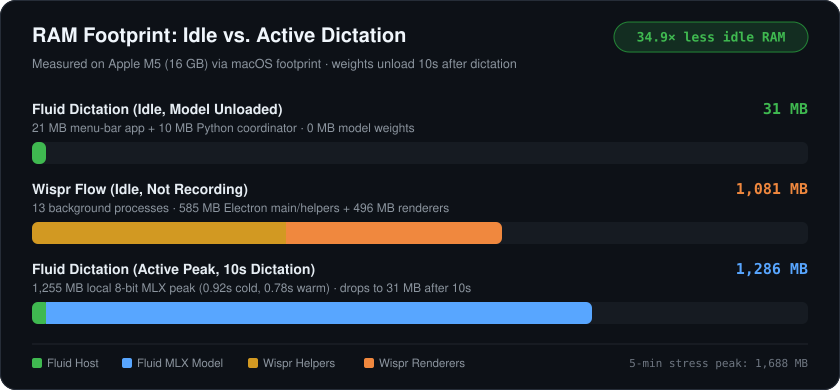
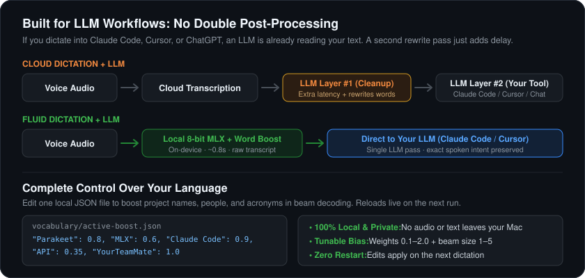

# Fluid Dictation (Fluid Speech Pro on Apple Silicon)

A lightweight macOS menu-bar dictation app built around [Fluid Speech Pro MLX](https://huggingface.co/FluidVoice-Labs/fluid-speech-pro-mlx). Press `Fn` anywhere on your Mac, speak, and the transcript gets pasted into whatever field has focus. Everything runs locally on Apple Silicon, and the model unloads from RAM 10 seconds after you finish speaking.



## Why I built this

### 1. Almost zero RAM when idle
Most dictation apps keep large runtimes sitting in memory all day even when you are not speaking. On an Apple M5 (16 GB) measured with macOS `footprint`:

| App / State | Memory Footprint | Notes |
|---|---:|---|
| Fluid Dictation (idle, model unloaded) | **31 MB** | 21 MB Swift app + 10 MB Python coordinator, 0 MB weights |
| Wispr Flow (idle, not recording) | **1,081 MB** | 13 processes (585 MB Electron helpers + 496 MB renderers) |
| Fluid Dictation (10s dictation peak) | **1,286 MB** | 1,255 MB 8-bit MLX peak (0.92s cold, 0.78s warm), then drops back to 31 MB |
| Fluid Dictation (5-minute stress peak) | **1,688 MB** | 30s chunks with a 128 MB MLX cache cap |

After 10 idle seconds, the worker kills the model child process and hands all model memory back to macOS.

### 2. Good enough daily transcription
For everyday English dictation, the 8-bit quantized Parakeet model (`~751 MB` on disk) is accurate enough to use as a daily driver and finishes a 10-second clip in under a second.

### 3. No extra LLM rewrite layer when talking to LLMs
If your main use case is dictating prompts into Claude Code, Cursor, Codex, or ChatGPT, an LLM is already about to read what you said. Running a cloud post-processing LLM inside your dictation app first adds a second network hop, slows things down, and sometimes rewrites technical terms before your actual coding agent sees them. Fluid Dictation drops the raw transcript straight into the text box.



### 4. Full control over your vocabulary
Instead of guessing what a closed app sends to its servers, you control recognition bias through a plain JSON file (`vocabulary/active-boost.json`) backed by `parakeet-mlx` beam search:

```json
{
  "weights": {
    "Claude Code": 0.9,
    "Parakeet": 0.8,
    "MLX": 0.6,
    "API": 0.35
  }
}
```

You can pick your own weights (`0.1` to `2.0`), tune `beam_size` (`1` to `5`) in `hotkey/config.json`, or disable boosting completely. The coordinator reloads these files on every dictation, so edits apply right away without rebuilding or restarting the app.

## Honest drawbacks

This setup fits a specific workflow and has real limits:

- **Not great for direct email writing or polished messages.** Because there is no LLM cleanup pass by default, filler words, self-corrections, and rough phrasing land verbatim. If you want one-click polished prose in Gmail or Slack, a cloud tool with an LLM rewrite step is a better match.
- **Not great at Hinglish right now.** The underlying model supports English and 24 other European languages. It does not support Hindi, so mixed Hindi-English speech will often come out garbled.
- **Can struggle with certain accents.** Depending on your accent and how fast you speak, some words and proper nouns still slip through. Vocabulary boosting helps on names you add, though it is a gentle bias rather than a hard override.

## Quick install (macOS, Apple Silicon)

### Option A: Download the DMG
1. Download `dist/Fluid-Dictation.dmg` from this repository and open it.
2. Double-click **Install Fluid Dictation.command**.

### Option B: Clone and run one script
```bash
git clone https://github.com/lockedin25/fluid-speech-pro.git
cd fluid-speech-pro
./setup.sh
```

### What `setup.sh` sets up automatically
1. Installs `uv` and `ffmpeg` (via Homebrew) if they are missing.
2. Creates an isolated Python 3.12 environment in `~/Library/Application Support/FluidDictation/.venv`.
3. Downloads the 8-bit model weights (`~751 MB`) and official loader from `FluidVoice-Labs/fluid-speech-pro-mlx` on Hugging Face and verifies them against `SHA256SUMS`.
4. Installs `Fluid Dictation.app` into `~/Applications/`.
5. Sets macOS `AppleFnUsageType` to `0` so pressing `Fn` does not pop up the Emoji picker, and adds a LaunchAgent so it starts at login.
6. Opens the app and prompts for Microphone and Accessibility permissions.

## Controls

- **Tap `Fn`** once to start recording, tap `Fn` again to transcribe and paste.
- **Hold `Fn`** to record while held and paste when released.
- **Backup shortcut:** `Control + Option + Space` works at any time.
- **Double-tap `Fn` to stop** (or tap `Fn` again while it says "Transcribing") to paste a polite, cleaned-up rewrite instead of the raw transcript. Opt-in per dictation; it makes one Gemini Flash-Lite call (about 0.5 to 0.8 s) and needs a key in `~/.config/fluid-dictation/gemini-api-key` or `$GEMINI_API_KEY`. If the call fails, the raw text is pasted.

To enable vocabulary boosting after installing, create `vocabulary/active-boost.json` inside `~/Library/Application Support/FluidDictation/` (or your cloned folder) and set `"enabled": true` in `hotkey/config.json`.

## CLI transcription

You can also transcribe audio files directly from the terminal (`HF_HUB_OFFLINE=1` after setup):

```bash
./transcribe /absolute/path/to/recording.m4a
./transcribe /absolute/path/to/recording.m4a --clean
./transcribe /absolute/path/to/recording.m4a --json results/my-recording.json
```

`--clean` enables the downloaded `clean-mode.safetensors` adapter (`55 MB`), which trims fillers and repetitions for recorded files.

## Credits

Huge thanks to the **FluidVoice** team for packaging and open-sourcing [Fluid Speech Pro MLX](https://huggingface.co/FluidVoice-Labs/fluid-speech-pro-mlx), along with the custom loader and clean-mode adapter that make local Apple Silicon inference this compact and quick.

Required upstream attribution:
> "Fluid Speech Pro by FluidVoice. Built on NVIDIA Parakeet TDT 0.6B v3 and Moondream Parakeet Ultra."

- [FluidVoice-Labs/fluid-speech-pro-mlx](https://huggingface.co/FluidVoice-Labs/fluid-speech-pro-mlx) (CC BY 4.0)
- [nvidia/parakeet-tdt-0.6b-v3](https://huggingface.co/nvidia/parakeet-tdt-0.6b-v3) (CC BY 4.0)
- [moondream/parakeet-ultra](https://huggingface.co/moondream/parakeet-ultra) (CC BY 4.0)

## License

- **App, worker, and setup scripts** (`hotkey/`, `setup.sh`, `transcribe`, `transcribe.py`): [MIT License](LICENSE).
- **Fluid Speech Pro MLX model weights and `fluid_speech_mlx.py` loader**: Creative Commons Attribution 4.0 International (**CC BY 4.0**), copyright FluidVoice.
